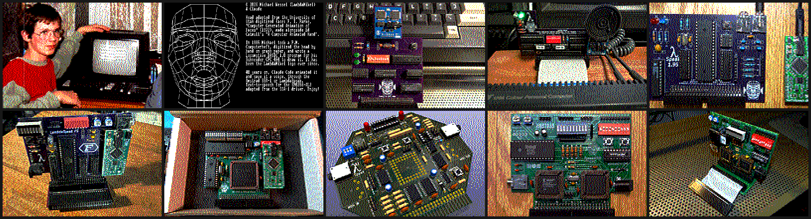

# CPC Slideshow

**A picture slideshow for the Amstrad / Schneider CPC 464, 664 and 6128 —
for the exhibit table.** It loops through its pictures unattended, each one
fading out through the CPC's half-intensity colours to black and the next
fading in, with the next picture already loaded while the current one is on
show. Turn your own directory of photos into CPC discs with one command.



*The demo disc, captured from MAME: Michael with the new Schneider CPC 464
and CTM 640 monitor, April 1985; the 1985 vector head (mode 2); LambdaSpeak 1
with the Emic-2, 1.5, 1.95 and FS; LambdaSpeak 3; LambdaSpeak AI; Speak&SID;
LambdaBoard.*

---

## Contents

- [Running the demo disc](#running-the-demo-disc)
- [Your own pictures: a whole directory](#your-own-pictures-a-whole-directory)
- [Choosing order, times and modes: the playlist](#choosing-order-times-and-modes-the-playlist)
- [Converting pictures without making a disc](#converting-pictures-without-making-a-disc)
- [Modes and picture quality](#modes-and-picture-quality)
- [How it works](#how-it-works)
- [Running a disc in MAME](#running-a-disc-in-mame)
- [Repository layout](#repository-layout)
- [Credits and licence](#credits-and-licence)

---

## Running the demo disc

The disc images are in [`disk/`](disk/):

| | |
|---|---|
| [`slideshow.dsk`](disk/slideshow.dsk) | for emulators (WinAPE, CPCEC, MAME, ...) and for writing to a real 3" or 3.5" disc |
| [`slideshow.hfe`](disk/slideshow.hfe) | for a Gotek (FlashFloppy) or HxC floppy emulator: copy it to the USB stick |

Then, on the CPC:

    RUN"SLIDES

A 464 needs a DDI-1 disc interface (or a Gotek on one). The screen goes black
for about five seconds while the viewer and the first picture load; after
that it runs forever.

- **Any key** skips to the next picture.
- **ESC twice** stops it, as with any BASIC program.

---

## Your own pictures: a whole directory

You need Python 3 with Pillow and NumPy, and the
[rasm](https://github.com/EdouardBERGE/rasm) Z80 assembler:

    pip install pillow numpy

**1. Put the pictures in a directory.** JPEG, PNG, GIF, BMP, WebP or TIFF,
any size. They are shown in file-name order, with numbers sorted as numbers
(`2.jpg` before `10.jpg`), so name them `01-…`, `02-…` to choose the order.
Anything that isn't a picture is ignored.

**2. Build the discs:**

    tools/build.py ~/Pictures/myshow

```
  01CPC.SCR         10 s  mode 0  01-cpc.jpg
  02HEAD.SCR        10 s  mode 2  02-head.png
  ...
build/slideshow.dsk/.hfe: 10 pictures, 172 of 178 KB
VIEW.BIN 472 bytes.  On the CPC: RUN"SLIDES
```

Each picture gets its own best 16 (or 4, or 2) of the CPC's 27 colours,
dithered, and the mode is chosen for it: photos get mode 0, and line art,
text and screenshots the mode that suits them (see [Modes](#modes-and-picture-quality)).

**3. Look at the previews.** `build/preview/` has a PNG of every picture
exactly as the CPC will show it. If a crop is wrong or a picture looks dull,
see [the playlist](#choosing-order-times-and-modes-the-playlist) for what can
be changed per picture.

**4. Try it in MAME** — it opens a CPC 6128 with the disc in the drive and
starts the slideshow by itself ([more](#running-a-disc-in-mame)):

    tools/run.sh build/slideshow.dsk       # or build/slideshow-1.dsk, -2.dsk, ...

**5. Put the disc on the CPC** — `build/slideshow.hfe` onto the Gotek's USB
stick, or `build/slideshow.dsk` into the emulator or onto a real disc — and
`RUN"SLIDES`.

### Options for the whole directory

    tools/build.py ~/Pictures/myshow --secs 8          # 8 seconds per picture (default 10)
    tools/build.py ~/Pictures/myshow --fit             # letterbox in black instead of cropping
    tools/build.py ~/Pictures/myshow --mode 1          # force a mode: 0, 1, 2 or auto (default)
    tools/build.py ~/Pictures/myshow --dither bayer    # fs (default), bayer or none
    tools/build.py ~/Pictures/myshow -o build/vcf      # build/vcf.dsk and .hfe

### More than ten pictures

A CPC DATA disc holds 178 KB: ten full-screen pictures. A bigger directory is
split over as many discs as it needs, in order:

```
build/slideshow-1.dsk/.hfe: 10 pictures, 172 of 178 KB
build/slideshow-2.dsk/.hfe: 10 pictures, 172 of 178 KB
build/slideshow-3.dsk/.hfe: 3 pictures, 53 of 178 KB
```

Each disc is complete — viewer, playlist and its share of the pictures — so
any of them can go in the drive and be `RUN"SLIDES`. With a Gotek, put them
all on the stick and switch between them with its buttons.

---

## Choosing order, times and modes: the playlist

For more control than file-name order and one time for all, write a
playlist. [`slides.txt`](slides.txt) is the demo disc's:

```
#   picture                 seconds  mode  options
pictures/mycpc.jpg          10       0
pictures/vecthead.png       12       2
pictures/emic4cpc.jpg        8       0     yalign=0.7
pictures/lambdaboard.jpg     8       0     name=LBOARD
```

Build it with:

    tools/build.py                       # slides.txt
    tools/build.py my-show.txt           # any other playlist

A `slides.txt` **inside a picture directory** is used automatically by
`tools/build.py DIR`, with the picture paths relative to the directory.

| column | |
|---|---|
| picture | the file, relative to the playlist |
| seconds | how long it stays up, default 10. The next picture loads during this time, which takes about 4 s, so less than about 5 just means "as fast as the disc goes". |
| mode | `0`, `1`, `2` or `auto` (default) |
| `fit` | letterbox in black instead of cropping to fill the screen |
| `xalign=` `yalign=` | where to crop, 0 to 1: `yalign=0` keeps the top, `1` the bottom, `0.5` (default) the middle |
| `bayer` / `none` | ordered dithering, or none; the default is Floyd–Steinberg |
| `saturation=` `contrast=` | colour and contrast boost; defaults 1.15 and 1.0 |
| `autocontrast=` | percent of darkest and lightest pixels clipped, default 0.5; 0 turns it off |
| `sharpen=` | unsharp mask, default 0.6; 0 turns it off |
| `strength=` | dithering strength, 0 to 1, default 0.85 |
| `name=` | the name on the disc, up to 8 letters and digits (default: from the file name) |

The command-line options (`--secs`, `--mode`, `--fit`, `--dither`) set the
defaults for every line that doesn't say otherwise.

---

## Converting pictures without making a disc

[`tools/pic2cpc.py`](tools/pic2cpc.py) does the conversion on its own, for
one picture or a whole directory, with the same options as the playlist:

    tools/pic2cpc.py photo.jpg PHOTO.SCR --preview photo.png
    tools/pic2cpc.py ~/Pictures/myshow out/            # every picture -> out/NAME.SCR + out/name.png
    tools/pic2cpc.py ~/Pictures/myshow out/ --mode 0 --fit --saturation 1.3

Each `.SCR` is a 16 KB screen dump with an AMSDOS header (load address
`&C000`), so it can go on any disc and be loaded from BASIC:

    MODE 0:LOAD"PHOTO.SCR",&C000

— though BASIC won't know its palette, which the file carries at offset
`&07D0` (below). `VIEW.BIN` reads it from there.

---

## Modes and picture quality

| mode | pixels | colours | for |
|---|---|---|---|
| 0 | 160 x 200 | 16 of 27 | photos |
| 1 | 320 x 200 | 4 of 27 | drawings, screenshots with few colours |
| 2 | 640 x 200 | 2 of 27 | text, line art |
| auto | | | the default — see below |

**auto** looks at each picture: one that is already CPC pixels — 160, 320 or
640 wide and 200 high, or 400 high line-doubled, like a MAME screenshot —
keeps its mode and goes across pixel for pixel, undithered (the vector head
above). A picture with only two colours gets mode 2, with four mode 1.
Anything else is a photo, mode 0.

**The palette** is chosen per picture: the 16 (4, 2) of the CPC's 27 colours
that fit it best, picked greedily and then improved by swapping until no
single swap helps. Pen 0 is always black — the fades pass through it and
letterboxing uses it.

**Cropping.** The CPC's picture area is about 1.5 times as wide as it is tall
on a monitor, so a 4:3 photo loses a little at the top and bottom, and a
portrait photo a lot. Use `yalign` to choose which part stays, or `fit` to
keep it all with black bars.

**Tips.** Photos with one clear subject and good light work best; dark,
busy scenes turn to noise in 16 colours. `saturation=1.3` helps a washed-out
picture, `contrast=1.2` a flat one. `bayer` dithering gives a regular
cross-hatch instead of noise — some prefer it on gradients.

---

## How it works

[`src/view.asm`](src/view.asm) is a 472-byte Z80 viewer at `&8000`, and
`SLIDES.BAS` is the playlist, calling it once per picture:

```
10 ' Picture slideshow -- made by tools/build.py
20 BORDER 0:FOR i=0 TO 15:INK i,0:NEXT:MODE 1
30 MEMORY &3FFF:LOAD"VIEW.BIN",&8000
40 POKE &BE78,&FF:' AMSDOS errors: no messages, no Retry/Ignore/Cancel
50 CALL &8000
60 RESTORE 1000
70 READ f$,s:IF f$="*" THEN 60
80 CALL &8003,@f$,s:GOTO 70
1000 DATA "MYCPC.SCR",10
...
```

It works through the firmware jumpblock only, so the same disc runs on the
464 (BASIC 1.0, DDI-1), the 664 and the 6128.

**Two screens.** The picture on show is at `&C000` or `&4000`; the next one
loads into the other while this one is up, so the disc time is spent inside
the display time. `MEMORY &3FFF` keeps BASIC out of `&4000`–`&7FFF`.

**Each picture carries its palette.** A `.SCR` has its mode, border colour
and 16 inks at offset `&07D0` — the first of the eight 48-byte gaps after
each block of 25 character rows, which are never displayed:

| offset | |
|---|---|
| `&07D0` | mode, 0–2 |
| `&07D1` | border, firmware colour 0–26 |
| `&07D2`–`&07E1` | pens 0–15, firmware colours 0–26 (the numbers `INK` takes) |

**Changing pictures in the dark.** When the time is up: fade out (full,
half, black), point the CRTC at the other screen with `SCR SET BASE`, set
the mode with `MC SET MODE`, wait a frame for the CRTC to take the new base,
fade in. Nothing is ever seen half loaded or in the wrong colours. The fade
steps each gun of each colour down a level: the CPC has exactly three, off,
half and full.

**Keeping time across the disc.** AMSDOS runs with interrupts off while it
waits for and reads sectors, and the firmware's 300 Hz clock stops with
them: loading a picture costs the clock about 2 seconds of the 4 it takes.
The viewer credits that back, so a picture stays up for the time the
playlist says, to within half a second (measured in MAME).

**No messages over the pictures.** `POKE &BE78,&FF` stops AMSDOS asking
*Retry, Ignore or Cancel?*, which would hang an unattended show. AMSDOS
still prints *not found* for a missing file, so text output is switched off
while loading. A picture that can't be loaded is skipped and the current
one stays up.

**The disc is interleaved** as AMSDOS's own FORMAT lays it down
(sectors C1 C6 C2 C7 C3 C8 C4 C9 C5). In plain order AMSDOS misses each next
sector and waits a whole turn of the disc for it: a picture took 16 s to
load instead of 4.

---

## Running a disc in MAME

    tools/run.sh build/slideshow-3.dsk   # a 6128 with that disc, slideshow started
    tools/run.sh                         # build/slideshow.dsk (or -1.dsk), else the demo disc
    tools/run.sh -m 464 disc.dsk         # a 464 with a DDI-1
    tools/run.sh -n disc.dsk             # just boot, don't type RUN"SLIDES
    SHOT_EVERY=2 RUN_SECONDS=120 tools/run.sh -shots /tmp/shots

MAME opens in a window, boots, and types `RUN"SLIDES` itself after three
seconds. MAME's own keys are kept active, so there is no Scroll Lock dance:

| key | |
|---|---|
| **Tab** | MAME's menu — *File Manager → floppydisk1* puts in another disc |
| **Insert** | the CPC's DEL (backspace). Backspace is the CPC's CLR, which deletes *forwards* |
| **`** | the CPC's ESC |
| **Esc** | quit MAME (it asks first) |

MAME maps the CPC keyboard by position, not by legend, hence Insert and `.

The headless form runs [`emu/show.lua`](emu/show.lua): it types
`RUN"SLIDES`, logs every flip to the frame with how long the picture was up,
and saves snapshots of the emulated monitor — real palette, real mode.
`SHOT_AFTER_FLIP=4` takes one snapshot per slide instead; the picture at the
top of this page was made that way.

Tested in MAME 0.264 on the 6128 and on the 464 with a DDI-1, a full loop
each, plus a playlist naming a missing file — and **on a real CPC 464, where
it works very well** (November 2026).

---

## Repository layout

```
disk/            the demo disc: slideshow.dsk and slideshow.hfe
pictures/        the demo pictures
slides.txt       the demo playlist
src/view.asm     the Z80 viewer
tools/build.py   playlist or directory -> disc images
tools/pic2cpc.py picture or directory -> .SCR files
tools/mkcpcdisk.py  AMSDOS DATA disc, as .dsk and .hfe
tools/amsdos.py  AMSDOS header for a binary
tools/run.sh     run a disc in MAME: windowed with RUN"SLIDES typed, or headless
emu/show.lua     MAME script: drive the slideshow, log it, snapshot it
docs/            screenshots
build/           what tools/build.py makes (not in git)
```

To update the demo disc after changing `slides.txt`:

    tools/build.py && cp build/slideshow.dsk build/slideshow.hfe disk/

Tools found on `PATH`, or set `RASM`, `MAME` and `CPCROMS` (the directory with
the CPC ROM sets for MAME).

---

## Credits and licence

- The slideshow, the converter and this README: **Claude Code** (Claude Opus 5),
  2026, working with Michael.
- `tools/mkcpcdisk.py` and `tools/amsdos.py` are from
  [LambdaSpeak 4](https://github.com/lambdamikel/lambdaspeak4), with the
  sector interleave added here.
- The demo pictures are Michael's, from the
  [LambdaSpeak](https://github.com/lambdamikel/LambdaSpeak),
  [LambdaSpeak 3](https://github.com/lambdamikel/LambdaSpeak3),
  [LambdaBoard](https://github.com/lambdamikel/LambdaBoard),
  [Speak&SID](https://github.com/lambdamikel/Speak-SID) and
  [vector head](https://github.com/lambdamikel/animated-speaking-cpc-vector-head)
  repositories.

GPL-3 — see [`LICENSE`](LICENSE).

© 2026 Michael Wessel (LambdaMikel) & Claude.
